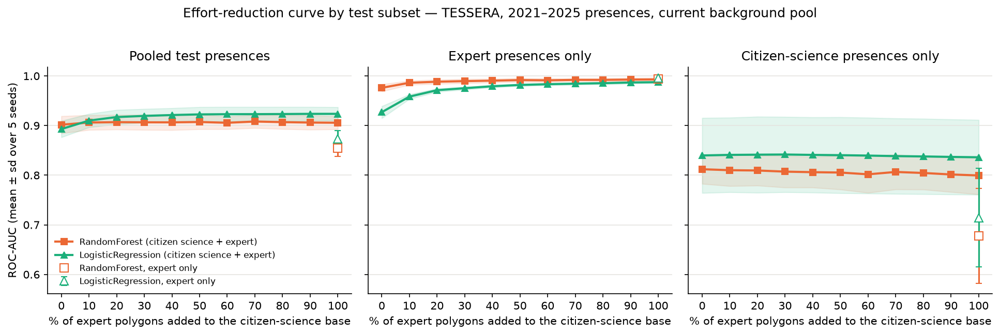

# Próxima Reunião com o Orientador — 2026-11-17

> Fila viva do que levar à próxima reunião. Decisões já tomadas ficam
> em [`thesis/notes.md`](../../thesis/notes.md#decisões); a reunião
> anterior está em [`2026-11-05.md`](2026-11-05.md).

## Formulação das perguntas: quatro perguntas, centradas na substituição (proposta minha, a confirmar)

Reorganizei as perguntas:

- **Principal:** em que medida a ciência cidadã, via embeddings de
  foundation models, pode substituir os dados de especialistas como
  **dados de treino** (o teste continua a ser de especialistas)?
- **RQ1 (substituição):** um modelo só com ciência cidadã atinge o
  desempenho de um treinado com dados de especialistas?
- **RQ2 (pontos → dados de referência):** os filtros de grau/precisão
  e a extensão do rótulo à mancha à volta alteram o desempenho?
- **RQ3 (transferibilidade):** o desempenho desce perto → longe da
  área amostrada?
- **RQ4 (representação):** o TESSERA melhora o mapeamento face ao
  Sentinel-2, com dados limpos, completos e poucos?

### RQ2: máscara de segmentação e filtros de qualidade

Proponho pôr a máscara de segmentação (que disse ser central) no
centro da RQ2, junto com os filtros de qualidade das observações.

- **Ideia:** ver se o modelo melhora quando cada observação passa de um
  píxel à mancha à volta (crescimento de região ou superpíxeis), e
  quando se aplicam os filtros de grau *research* e de precisão até
  30 m.
- **Como:** igual à curva da RQ1, só TESSERA. Ainda não corrido.

### RQ3: o modelo piora longe das observações?

As observações de ciência cidadã estão concentradas (quase todas de um
observador). Antes de tentar corrigir isso, proponho medir se prejudica
o modelo.

- **Ideia:** treinar com ciência cidadã e comparar o desempenho nos
  polígonos de especialistas perto (≤1 km) e longe (>1 km) das
  observações.
- **Produto:** um mapa de confiança que mostra onde o modelo está longe
  dos dados de treino.
- Ainda não corrido.

## Resultados a apresentar: curva de redução de esforço (RQ1)

**O modelo:** aprende a distinguir dois tipos de pontos, **acácia**
(presenças) e **fundo** (pontos ao acaso na paisagem), e dá a cada
sítio uma nota de quão parecido é com acácia.

**One-class:** testei o one-class que sugeriu (One-Class SVM, treinado
só com acácia, sem fundo), mas ficou perto do acaso só com ciência
cidadã e muito abaixo do modelo acácia vs. fundo sempre que a ciência
cidadã entra no treino. Por isso a curva usa acácia vs. fundo (Random
Forest).

Curva completa (0–100% de polígonos de especialistas sobre a base de
ciência cidadã, só TESSERA, presenças 2021–2025), testada por fonte.

**Métrica (eixo vertical): ROC-AUC.**

- **O que o modelo faz:** para cada sítio do mapa dá uma **nota** de 0
  a 1 que diz quão parecido o sítio é com acácia. Não diz "é" ou "não
  é" acácia: dá só a nota.
- **Que pontos usamos para o avaliar:** na zona de teste há dois tipos
  de pontos:
  - **sítios onde sabemos que há acácia** (as presenças);
  - **pontos ao acaso na paisagem** (o fundo): eucaliptal, pinhal,
    campo, estrada… quase sempre sem acácia.
- **A métrica:** junta-se um sítio com acácia e um ponto de fundo, e
  vê-se se o modelo dá nota mais alta ao sítio com acácia; a ROC-AUC é
  a fração de pares em que acerta (0,5 = tanto faz como atirar uma
  moeda; 1 = acerta sempre).

(Porquê a ROC-AUC: não precisa de escolher um corte do tipo "acima de 0,5 é
acácia"; limitação: o fundo pode ter acácia não registada, por isso nunca
chega a 1 e o máximo possível é desconhecido — Phillips et al., 2009.)

**O gráfico em resumo** (eixo horizontal: % de polígonos de
especialistas juntos à ciência cidadã; faixa: variação entre as cinco
sementes; marcadores ocos aos 100%: modelo só de especialistas).
Lido pela linha do Random Forest:

- **Esquerda (todas as presenças de teste): a linha é quase plana.**
  Juntar especialistas quase não melhora o resultado global. É a
  resposta principal da RQ1.
- **Meio (só presenças de especialistas): fáceis de reconhecer.** Mesmo
  sem nenhum dado de especialista no treino, o modelo já os reconhece
  muito bem; juntá-los melhora só um pouco.
- **Direita (só presenças de ciência cidadã): mais difíceis.** A linha
  fica abaixo das dos outros painéis, e o modelo só de especialistas
  cai bastante: quem treina só com especialistas reconhece pior os
  sítios que os cidadãos fotografam.
- **Direita: a faixa verde (Logistic Regression) é muito larga.** O
  resultado depende muito da zona testada. Uma das sementes tem muito
  poucas presenças de ciência cidadã no teste; que isto explique a
  variação é uma hipótese provável, não testada.

**Porque a curva deu plana, testei quatro explicações:**

- **Fundo fácil demais?** Repeti com um fundo só de floresta: a curva
  continua plana.
- **Píxeis repetidos dentro dos polígonos?** Há redundância, mas não
  chega para explicar.
- **Erros nos rótulos de ciência cidadã?** Tirar as presenças mais
  estranhas não melhora.
- **Habitat:** a explicação mais provável. Os especialistas mapearam
  sobretudo manchas de acacial, que a ciência cidadã já cobre; a
  ciência cidadã cobre também pinhal, eucaliptal e matos.

## Perguntas

- **Máscara, "área de vegetação mais próxima":** estender o rótulo à
  mancha à volta, ou só levar o ponto para dentro da vegetação mais
  próxima? Assumo a primeira leitura.

- **Validação independente da curva (RQ1):** plano é comparar com
  "Florestas de acácias" (COS 2023). Confirmar que os polígonos foram
  feitos sem apoio da COS — 56% caem nessa classe.

- **Polígonos `classifica = 0` como ausências só no teste:** não
  entram no estudo, mas os que caem em vegetação (56% dos 5 013)
  podem servir de ausências verificadas, só na avaliação (treino
  presença-vs-fundo não muda)? São fiáveis, e como foram escolhidos?

  Sem ausências confirmadas não meço falsos positivos (o Boyce já
  satura perto de 0,99); ganhava exatidão do utilizador/produtor para
  acácia, com dados que já existem.